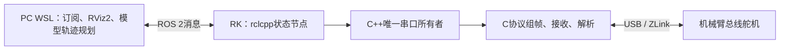

# Jixiebi：RK3568与ROS 2的C/C++机械臂学习项目

当前主线是 **PC上位机＋RK3568下位机＋ZLink＋总线舵机机械臂**：从C语言协议开始，用C++完成Linux串口与六轴查询，再用 rclcpp 发布 ROS 2 状态，并在 PC 上用同一模型学习正逆运动学、轨迹 Action 和起停加速度。课程逐段解释代码，附中文注释、编译方法和执行位置。项目仍在开发，当前不提供一键抓取或默认实物运动。



SSH 用于登录和部署。第 13 课在作者的 WSL Humble 与 RK Jazzy 之间收到了六轴反馈；跨发行版的其他接口与网络环境需要分别验证。第 15～23 课可仅用 PC 学习。

## 按课程学习

| 课程 | 学什么 | 操作位置 |
| --- | --- | --- |
| [1：查询组帧](docs/learning/C_LESSON01_QUERY.md) | 数组、指针、容量、格式化查询帧 | PC WSL，不接设备 |
| [2：完整回包解析](docs/learning/C_LESSON02_REPLY.md) | 长度、帧标记、数字与编号校验 | PC WSL，不接设备 |
| [3：半包/粘包缓冲](docs/learning/C_LESSON03_RECEIVER.md) | 结构体、有界接收状态机、重同步 | PC WSL，不接设备 |
| [4：C++串口查询](docs/learning/CPP_LESSON04_SERIAL.md) | RAII、termios、poll、完整读写与超时 | WSL编译，RK只读 |
| [5：六轴结构化查询](docs/learning/CPP_LESSON05_ARM_STATE.md) | struct、array、引用、顺序调度 | WSL编译，RK只读 |
| [6：rclcpp状态发布](docs/learning/CPP_LESSON06_ROS_PUBLISHER.md) | Node、Message、Publisher、Timer、spin | RK发布与本机订阅 |
| [7：Service请求与响应](docs/learning/CPP_LESSON07_SERVICE.md) | 自定义srv、服务回调、客户端、future与有界等待 | PC WSL，静态软件示例 |
| [8：Action模拟任务](docs/learning/CPP_LESSON08_ACTION.md) | 发送目标、订阅进度、取消并读取最终结果 | PC WSL，两个本机C++节点 |
| [9：在RViz2显示方块](docs/learning/CPP_LESSON09_MARKER.md) | 发布标准Marker，理解坐标系、中心、边长与颜色 | PC WSL，C++节点与RViz2图形窗口 |
| [10：在线改颜色与尺寸](docs/learning/CPP_LESSON10_PARAMETERS.md) | 声明和校验节点参数，用 Launch 同时启动 C++ 节点与 RViz2 | PC WSL，一边观察一边调参 |
| [11：从底座看工具的位置](docs/learning/CPP_LESSON11_TF.md) | 用 C++ 广播静态和动态 TF，用 tf2_echo 查父子及跨级变换，在 RViz2 看坐标轴 | PC WSL，模拟工具绕底座转动 |
| [12：让机械臂模型动起来](docs/learning/LESSON12_URDF_XACRO.md) | 写 Xacro 连杆和关节，用模拟 JointState 驱动 robot_state_publisher，在 RViz2 看整条臂 | PC WSL，四个关节滑块 |
| [13：从 WSL 接收 RK 六轴反馈](docs/learning/LESSON13_RK_TO_WSL.md) | 局域网发现、同域订阅、按批次区分网络与设备查询问题 | RK Jazzy 发布，PC WSL Humble 订阅 |
| [14：从实读 P 到 RViz2 关节角](docs/learning/LESSON14_FEEDBACK_JOINT_STATES.md) | 复用厂家方向与工作零位显示四轴；按需要用两点标定和第三点检验实际角度 | RK 沿用第十三课，转换和显示在电脑 WSL |
| [15：写第一条关节轨迹](docs/learning/CPP_LESSON15_TRAJECTORY.md) | 用 C++ 把第 198 批的四轴姿态写成标准 JointTrajectory，在话题中核对列名、弧度、累计到达时间 | 电脑 WSL，发布与订阅；RK 可关机 |
| [16：让 RViz2 播放这条轨迹](docs/learning/CPP_LESSON16_TRAJECTORY_PLAYBACK.md) | 用单调时钟找出当前路段，以三次插值生成四轴 JointState，看肘在第 2 秒换向、第 4 秒返回 | 电脑 WSL 两个终端，复用第十二课彩色模型 |
| [17：通过 Action 播放与取消](docs/learning/CPP_LESSON17_FOLLOW_ACTION.md) | 用标准 FollowJointTrajectory 发送同一条轨迹，读取 desired/actual，核对成功、取消和姿态保持 | 电脑 WSL 两个终端，RViz2 模型 |
| [18：从当前姿态接着走](docs/learning/CPP_LESSON18_FROM_STATE.md) | 读取模型 JointState 生成两点轨迹，核对起点，从取消位置平滑走向指定肘角 | 电脑 WSL 两个终端，沿用轨迹 Action 与彩色模型 |
| [19：从关节角算工具端位置](docs/learning/CPP_LESSON19_TOOL_POSITION.md) | 读取运行中的 URDF 和四轴 JointState，用 KDL 正运动学计算黄色工具点相对底座的 XYZ | 电脑 WSL，在两个静止模型姿态比较毫米坐标 |
| [20：从工具坐标反求关节角](docs/learning/CPP_LESSON20_TOOL_IK.md) | 输入 XYZ 与工具俯仰，求腕点、选肘角分支，用模型 Action 播放并回读工具点 | 电脑 WSL，沿用第十九课模型和两个终端 |
| [21：让工具端走直线](docs/learning/CPP_LESSON21_CARTESIAN_LINE.md) | 在线段上取点并逐点逆解，用 Action 反馈画出球心轨迹，比较沿途和终点的偏差 | 电脑 WSL，RViz2 双终端实验 |
| [22：给直线轨迹安排巡航速度](docs/learning/CPP_LESSON22_SPEED_PROFILE.md) | 梯形速度时间律、逐点逆解、从相邻模型反馈求速率，比较 35 和 25 mm/s | 电脑 WSL，RViz2 看轨迹、终端测速 |
| [23：比较起停时的加速度](docs/learning/CPP_LESSON23_ACCELERATION.md) | 同一条线、同一用时，比较梯形速度与三次平滑速度，从三个球心位置估算加速度 | 电脑 WSL，RViz2 和速度、加速度对照图 |

首次上板见[从公开源码部署到RK](docs/learning/RK_DEPLOYMENT.md)。其他内容见[代码与文档分类](docs/README.md)，后续顺序见[工程计划](docs/FULL_ARM_PLAN.md)。

## 当前验证到哪里

以下实物结果来自作者在特定装配上的终端反馈，不承诺其他硬件获得相同数值或表现。

| 范围 | 已完成 | 尚未验证 |
| --- | --- | --- |
| C协议 | 查询组帧、完整回复、半包/粘包及边界测试 | 新协议/其他舵机型号 |
| C++设备层 | RK六轴只读批次成功；一次批次约41.297ms | 长期调度与各类实机故障恢复 |
| rclcpp | RK Jazzy本机收到六轴自定义消息；一次批次43.063ms、有效6/6 | 其他跨发行版接口、全轴实测标定 |
| PC开发环境 | WSL Humble 模型轨迹与速度/加速度对照；第 14 课显示真实反馈对应的标称模型 | 实机动态跟随精度、轨迹速度与加速度 |
| 旧Python基线 | 协议、规划、有限动作与合成静态图示例保留 | 新C++动作执行、可靠抓放、视觉引导 |

P值是协议单位，不是弧度或毫米；顺序读取六轴不是同步采样。驱动响应、严格到位、物体夹持、空间精度和物理停止分别验收。

## 不接机械臂也能开始

在有GCC、G++、Python 3的Linux/WSL中：

```bash
git clone https://github.com/fanxucheng74-ux/Jixiebi.git
cd Jixiebi
# 三项纯C边界检查＋C++构建＋本地伪终端测试；不访问真实设备。
bash tools/check_native.sh
```

ROS课程使用系统ROS环境，构建不会打开串口。默认CLI未明确给端口不连接设备；ROS节点默认空端口拒绝打开。真实查询需按教程选择设备、确认供电/权限与唯一串口所有者。

Python历史基线和完整公开离线验收见[Python快速开始](docs/QUICKSTART.md)。默认验收不需要作者私有日志，私有证据检查仅在明确使用`--private-evidence`时执行。

## 目录分工

```text
native/                         当前主线：C协议、C++驱动、CLI与原生测试
ros2_ws/src/jixiebi_interfaces/  当前主线：原始状态消息
ros2_ws/src/jixiebi_hardware/    当前主线：rclcpp薄适配，复用native核心
ros2_ws/src/jixiebi_learning/    PC 课程、模型与运动学仿真
ros2_ws/src/jixiebi_joint_state_bridge/  真实反馈到模型角的只读转换
docs/learning/                  第 1～23 课、模型事实表与分端部署教程
tools/                          构建、白名单打包、离线检查
legacy/ros2_ws/                 旧Python ROS节点与标称模型
legacy/firmware/                早期ESP32尝试，已退出当前方案
src/arm_project/                Python对照/视觉/规划基线，保留导入兼容
tests/、configs/、data/         Python基线测试、合成样例与示例配置
```

[历史代码说明](legacy/README.md)解释旧实现的用途。当前课程入口为 native、四个 ROS 包和学习目录。

## 后续方向与贡献

下一阶段关注本机关节标定、真实轨迹跟随误差和有限动作验收。[学习目录](docs/learning/README.md)提供 WSL 的首次安装步骤，[第 23 课](docs/learning/CPP_LESSON23_ACCELERATION.md)可以直接复现 140 mm 模型横移的速度和加速度对照。

开发与检查约定见[贡献指南](CONTRIBUTING.md)。代码采用[MIT许可证](LICENSE)；该许可不覆盖厂商资料或其他第三方代码。
