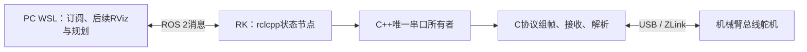

# Jixiebi：RK3568与ROS 2的C/C++机械臂学习项目

当前主线是 **PC上位机＋RK3568下位机＋ZLink＋总线舵机机械臂**：从C语言协议开始，用C++完成Linux串口与六轴查询，再用rclcpp发布ROS 2状态。课程逐段解释代码，附中文注释、编译方法和执行位置。项目仍在开发，当前不提供一键抓取或默认实物运动。



SSH用于登录和部署；正式PC↔RK的ROS通信还需统一发行版并单独验收。RK已有Jazzy，作者PC当前使用Humble，现阶段分别验证，不默认跨版本DDS互通。

## 按课程学习

| 课程 | 学什么 | 操作位置 |
| --- | --- | --- |
| [1：查询组帧](docs/learning/C_LESSON01_QUERY.md) | 数组、指针、容量、格式化查询帧 | PC WSL，不接设备 |
| [2：完整回包解析](docs/learning/C_LESSON02_REPLY.md) | 长度、帧标记、数字与编号校验 | PC WSL，不接设备 |
| [3：半包/粘包缓冲](docs/learning/C_LESSON03_RECEIVER.md) | 结构体、有界接收状态机、重同步 | PC WSL，不接设备 |
| [4：C++串口查询](docs/learning/CPP_LESSON04_SERIAL.md) | RAII、termios、poll、完整读写与超时 | WSL编译，RK只读 |
| [5：六轴结构化查询](docs/learning/CPP_LESSON05_ARM_STATE.md) | struct、array、引用、顺序调度 | WSL编译，RK只读 |
| [6：rclcpp状态发布](docs/learning/CPP_LESSON06_ROS_PUBLISHER.md) | Node、Message、Publisher、Timer、spin | RK发布与本机订阅 |

首次上板见[从公开源码部署到RK](docs/learning/RK_DEPLOYMENT.md)。其他内容见[代码与文档分类](docs/README.md)，后续顺序见[工程计划](docs/FULL_ARM_PLAN.md)。

## 当前验证到哪里

以下实物结果来自作者在特定装配上的终端反馈，不承诺其他硬件获得相同数值或表现。

| 范围 | 已完成 | 尚未验证 |
| --- | --- | --- |
| C协议 | 查询组帧、完整回复、半包/粘包及边界测试 | 新协议/其他舵机型号 |
| C++设备层 | RK六轴只读批次成功；一次批次约41.297ms | 长期调度与各类实机故障恢复 |
| rclcpp | RK Jazzy本机收到六轴自定义消息；一次批次43.063ms、有效6/6 | PC↔RK跨机DDS、标定后的JointState |
| PC开发环境 | WSL Humble构建与本机ROS＋PTY收发测试 | 正式同版本多机环境、当前主线RViz实物显示 |
| 旧Python基线 | 协议、规划、有限动作与合成静态图示例保留 | 新C++动作执行、可靠抓放、视觉引导 |

P值是协议单位，不是弧度或毫米；顺序读取六轴不是同步采样。驱动响应、严格到位、物体夹持、空间精度和物理停止分别验收。

## 不接机械臂也能开始

在有GCC、G++、Python 3的Linux/WSL中：

```bash
git clone https://github.com/fanxucheng74-ux/Jixiebi.git
cd Jixiebi
# 三项纯C边界检查＋C++构建＋本地伪终端测试；不访问真实设备。
bash tools/check_native.sh
```

ROS课程使用系统ROS环境，构建不会打开串口。默认CLI未明确给端口不连接设备；ROS节点默认空端口拒绝打开。真实查询需按教程选择设备、确认供电/权限与唯一串口所有者。

Python历史基线和完整公开离线验收见[Python快速开始](docs/QUICKSTART.md)。默认验收不需要作者私有日志，私有证据检查仅在明确使用`--private-evidence`时执行。

## 目录分工

```text
native/                         当前主线：C协议、C++驱动、CLI与原生测试
ros2_ws/src/jixiebi_interfaces/  当前主线：原始状态消息
ros2_ws/src/jixiebi_hardware/    当前主线：rclcpp薄适配，复用native核心
docs/learning/                  当前六课与统一部署教程
tools/                          构建、白名单打包、离线检查
legacy/ros2_ws/                 旧Python ROS节点与标称模型
legacy/firmware/                早期ESP32尝试，已退出当前方案
src/arm_project/                Python对照/视觉/规划基线，保留导入兼容
tests/、configs/、data/         Python基线测试、合成样例与示例配置
```

[legacy说明](legacy/README.md)解释保留原因。历史实现可阅读和测试，当前课程以native和两个新ROS包为准。原始照片、现场配置、动作预算、日志、权重、虚拟环境和构建产物不上传。

## 后续方向与贡献

接下来学习Service、模拟Action、PC上的RViz Marker、动态参数/Launch、tf2与URDF；再统一PC/RK环境、标定映射、接入真实显示及有限轨迹。每个阶段以用户可解释代码、能复现运行并看懂结果为目标。

开发与检查约定见[贡献指南](CONTRIBUTING.md)。代码采用[MIT许可证](LICENSE)；该许可不覆盖厂商资料或其他第三方代码。
