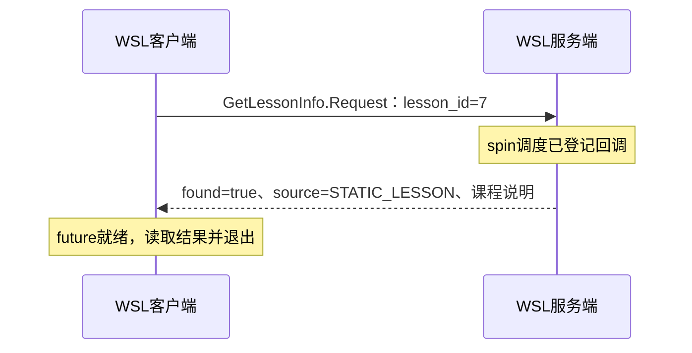

# C++第七课：Service请求、响应与自定义接口

下一课在电脑WSL运行[第八课Action模拟任务](CPP_LESSON08_ACTION.md)，观察一个目标从接受、反馈到结束的过程。

本课在电脑WSL的ROS 2 Humble运行两个软件节点：发送课程编号，返回静态课程说明。不登录RK、不打开串口、不启动旧控制程序。第六课RK状态发布代码不变，本课也不要求它运行。

## 1. 从Topic切换到Service

| 第六课Topic | 本课Service |
| --- | --- |
| 发布者按定时器连续发布状态 | 客户端明确发送请求，服务端返回对应响应 |
| 订阅者关注不断更新的数据 | 客户端关注这一次请求的处理结果 |
| 我们用它发布六轴反馈 | 先用它查询静态课程资料 |

Service适合较快完成的请求/响应。后续持续运动需要进度和取消，学习Action，不让一个Service回调长时间占住执行器。客户端超时也不代表服务端取消或动作停止。

本课一次正常调用：



STATIC_LESSON说明这是静态示例，不是舵机反馈，也不是程序记录了你的学习进度。

## 2. 写在哪些文件

以下假设在 WSL 将项目克隆到 `$HOME/Jixiebi`。参考实现已放入下列文件，可逐段对照手写/修改；不要往文件末尾重复追加main。

| 文件 | 负责什么 |
| --- | --- |
| [GetLessonInfo.srv](../../ros2_ws/src/jixiebi_interfaces/srv/GetLessonInfo.srv) | 声明请求和响应字段 |
| [接口CMakeLists.txt](../../ros2_ws/src/jixiebi_interfaces/CMakeLists.txt) | 把srv交给生成器 |
| [lesson07_service_server.cpp](../../ros2_ws/src/jixiebi_learning/src/lesson07_service_server.cpp) | 收到请求，填写响应 |
| [lesson07_service_client.cpp](../../ros2_ws/src/jixiebi_learning/src/lesson07_service_client.cpp) | 发送一次请求，等待并显示响应 |
| [学习包CMakeLists.txt](../../ros2_ws/src/jixiebi_learning/CMakeLists.txt) / [package.xml](../../ros2_ws/src/jixiebi_learning/package.xml) | 构建和安装两个节点，声明ROS依赖 |

在电脑WSL打开服务端：

```bash
cd $HOME/Jixiebi
# nano是文本编辑器，修改后Ctrl+O保存，Ctrl+X退出。
nano ros2_ws/src/jixiebi_learning/src/lesson07_service_server.cpp
```

## 3. srv：先约定输入和输出

GetLessonInfo.srv的核心内容：

```text
uint8 lesson_id
---
bool found
string source
string title
string message
```

- `---`上面是请求，下面是响应；不是Shell语法，也不是C++代码。
- `lesson_id`是课程编号。本课查询7，不是舵机007或目标P；uint8表示0～255范围的无符号整数。
- `found`是业务结果：false表示服务已响应，但没有找到资料；不能把“收到回包”和“业务成功”混为一谈。
- `source/title/message`分别为数据来源、课程标题及说明。

colcon根据srv生成C++头文件`jixiebi_interfaces/srv/get_lesson_info.hpp`和Python类型。生成代码放build/install，自己只维护srv。在接口CMake已有rosidl_generate_interfaces中新增`"srv/GetLessonInfo.srv"`，原两个msg继续保留。

## 4. 服务端：main登记对象，spin调度回调

先看main里的主链，完整文件还包含异常处理：

```cpp
rclcpp::init(argc, argv);  // 初始化ROS环境和参数处理。
auto node = std::make_shared<LessonInfoServer>();  // 构造节点，登记服务回调。
rclcpp::spin(node);       // 持续处理请求，直到Ctrl+C等使ROS退出。
rclcpp::shutdown();       // 清理ROS资源。
```

构造函数里的create_service并不立即执行查询。它登记服务名、类型和回调，然后返回一个服务对象。service_是类成员，保存这个对象，避免构造结束后服务就被析构。

```cpp
using GetLessonInfo = jixiebi_interfaces::srv::GetLessonInfo;
// GetLessonInfo只是长类型名的别名；service_在类内声明为Service的SharedPtr。
service_ = create_service<GetLessonInfo>(
    "/jixiebi/learning/get_info",
    [this] (const std::shared_ptr<GetLessonInfo::Request> request,
           std::shared_ptr<GetLessonInfo::Response> response) {
        // 这里是回调函数体；真实项目中要尽快完成，不能阻塞做长运动。
        response->source = "STATIC_LESSON";
        response->found = request->lesson_id == 7;
        // 完整源码根据found填写title/message，再记录日志。
    });
```

`<GetLessonInfo>`指定接口类型；第一个参数指定服务名，第二个参数是lambda回调。`[this]`让回调使用本节点的get_logger等成员。request/response是指向请求/响应对象的共享指针，`->`用来访问对象字段；它们不是串口数据地址。

ROS收到请求后，spin调度回调，把收到的字段交给request。我们填写response，回调返回后ROS发送响应，不需手写ASCII帧或手工调用网络write。服务端源码只支持编号7；其他编号返回found=false、空title及解释。

## 5. 客户端：一次发送，等待future

客户端main创建普通Node，再调用query_lesson(node)。query_lesson的主链：

```cpp
auto client = node->create_client<GetLessonInfo>("/jixiebi/learning/get_info");
// 完整源码先wait_for_service(5s)，未发现则退出，没有发送请求。
auto request = std::make_shared<GetLessonInfo::Request>();
request->lesson_id = 7;  // 填写srv的输入字段。
auto future = client->async_send_request(request);  // 只发送一次。
const auto outcome = rclcpp::spin_until_future_complete(node, future, 5s);
// 完整源码仅在SUCCESS后执行future.get()取得Response指针。
```

`async_send_request`先发请求，返回future，不在这一行等待响应；future表示“稍后可以取得的结果”。等待期间仍需处理ROS事件，所以用spin_until_future_complete；不是sleep五秒，也不是让服务端main调用客户端函数。

发现服务和等待响应各最多5秒，最坏会累计接近10秒及系统调度开销。失败不自动重发；超时/中断会用remove_pending_request清理客户端本地等待记录，这不是取消远端执行。完整源码先检查outcome，成功才get，避免无期限等待。

客户端退出码：0=找到课程；1=业务未找到或异常；2=未发现服务；3=等待响应超时/中断。`FOUND=true`是这个示例的业务成功，不能用于证明真实机械臂完成任务。

## 6. 电脑WSL：编译一次

使用电脑WSL终端，不是在RK的SSH终端，也不是Windows PowerShell。以下命令在已有Humble环境运行，不重装ROS、不改变RK。

```bash
# 退出当前终端的Python虚拟环境，让ROS使用系统环境。
if type deactivate >/dev/null 2>&1; then deactivate; fi
source /opt/ros/humble/setup.bash
cd $HOME/Jixiebi/ros2_ws

# interfaces生成类型，learning编译服务端/客户端；不构建或启动硬件包。
CMAKE_BUILD_PARALLEL_LEVEL=1 colcon build \
  --packages-select jixiebi_interfaces jixiebi_learning --executor sequential \
  --cmake-args -DCMAKE_BUILD_TYPE=Release -DPython3_EXECUTABLE=/usr/bin/python3
```

预期末尾`Summary: 2 packages finished`。构建成功后：

```bash
# 让本终端找到刚编译的包和生成类型；不会启动节点。
source $HOME/Jixiebi/ros2_ws/install/setup.bash
# 查看请求/响应结构，应看到lesson_id、---和四个响应字段。
ros2 interface show jixiebi_interfaces/srv/GetLessonInfo
```

CMake的add_executable把每份cpp编成一个程序；ament_target_dependencies提供rclcpp与接口依赖；install把程序安装到ros2 run能找到的位置。新增cpp不等于ROS自动发现可执行程序，必须登记并重新构建。

## 7. 电脑WSL：两个终端运行

终端A运行服务端，保持窗口打开：

```bash
source /opt/ros/humble/setup.bash
source $HOME/Jixiebi/ros2_ws/install/setup.bash
# 此设置只用于本课本机练习，两边保持相同，不改RK配置。
export ROS_LOCALHOST_ONLY=1
export ROS_DOMAIN_ID=17
ros2 run jixiebi_learning lesson07_service_server
```

预期出现“静态课程服务就绪”。终端B也是电脑WSL，执行：

```bash
source /opt/ros/humble/setup.bash
source $HOME/Jixiebi/ros2_ws/install/setup.bash
export ROS_LOCALHOST_ONLY=1
export ROS_DOMAIN_ID=17
# 启动客户端：查7一次，显示结果后自动退出。
ros2 run jixiebi_learning lesson07_service_client
```

预期输出包含：

```text
SOURCE=STATIC_LESSON
LESSON_ID=7
FOUND=true
TITLE=ROS 2 Service请求与响应
MESSAGE=仅返回静态课程说明，不表示学习已完成或硬件已连接。
```

终端A应出现“lesson_id=7，found=true”。客户端退出后服务端仍等待下一次请求；停止服务端用终端A的Ctrl+C。

## 8. 用CLI看懂一问一答

在已加载环境的终端B运行，不需要新终端或编译：

```bash
# 查看服务类型；客户端和服务端必须使用同名、同类型。
ros2 service type /jixiebi/learning/get_info
# CLI也能充当客户端；这里的7写进Request.lesson_id。
ros2 service call /jixiebi/learning/get_info \
  jixiebi_interfaces/srv/GetLessonInfo '{lesson_id: 7}'
# 请求确实到达，但资料不存在：预期found=false，不是通信失败。
ros2 service call /jixiebi/learning/get_info \
  jixiebi_interfaces/srv/GetLessonInfo '{lesson_id: 99}'
```

服务未启动时，ros2 service call可能持续等发现，可Ctrl+C退出；本课C++客户端则有自己的5秒期限。没有重复请求和运动恢复语义。客户端和服务端的ROS_DOMAIN_ID、本机限制必须一致，新终端均需source同一工作区。

常见错误：Package not found先source install；找不到生成头先检查srv登记和interfaces构建；5秒未发现先看服务端是否仍运行及两个终端环境是否一致。不要因此重装ROS或去RK改串口。

## 9. 练习与项目里的用途

先运行成功，再做一个小改动：把客户端request->lesson_id从7改为99，仅重编译jixiebi_learning并重新运行客户端，预测FOUND和退出码。服务端不需改动。本课要能解释：是main发送请求，还是服务回调主动循环？改请求字段后，哪边收到这个值？

后续项目中，Topic继续广播设备状态；Service可用于快速配置/信息查询，若查询串口也必须经唯一所有者调度；Action负责耗时任务的目标、反馈、结果与取消。不能再开一个Service节点去抢第六课串口。本课仅搭好ROS基础理解，不把示例服务直接当运动控制器。

参考：[ROS官方C++ Service教程源码](https://github.com/ros2/ros2_documentation/blob/humble/source/Tutorials/Beginner-Client-Libraries/Writing-A-Simple-Cpp-Service-And-Client.rst)、[官方自定义接口教程](https://github.com/ros2/ros2_documentation/blob/humble/source/Tutorials/Beginner-Client-Libraries/Custom-ROS2-Interfaces.rst)。下一课学习模拟Action，不控制实物。
