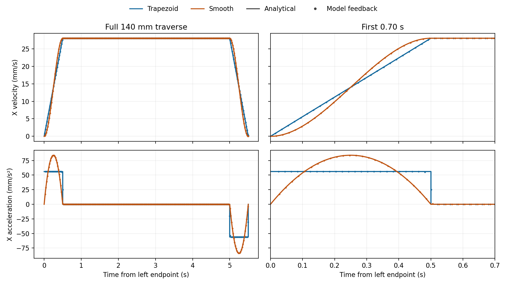

# 第 23 课 · 速度相同，起步和刹车有什么区别？

你已经在第 22 课验证 28 mm/s、横移 5.5 秒。今天保持这两个数，沿用同一份 URDF 和几何逆解。球心在 `base_link` 中从 (−70, 180, 445) 走到 (+70, 180, 445) mm，工具俯仰保持 55°。两个终端都在电脑 WSL Humble，数据来自 ROS 模型反馈。[模型与已测条件](ARM_FACTS.md)

## 1. 在 C++ 中写两种起步函数

打开 [lesson23_ramp_profile.hpp](../../ros2_ws/src/jixiebi_learning/src/lesson23_ramp_profile.hpp)，先写 `speed_mm_s()` 的起步部分，再对照 `accel_mm_s2()`。给起步时间取名 `R`，这里是 0.5 秒。用 `u=t/R` 表示起步过程走完了多少，范围为 0 到 1；`V=28` 的单位是 mm/s。

| 起步方式 | 速度 v，mm/s | 加速度 a，mm/s² | t=0.25 s |
|---|---|---|---|
| 梯形速度的线性起步 | V·u | V/R | v=14，a=56 |
| 三次平滑起步 | V·(3u²−2u³) | (V/R)·6u(1−u) | v=14，a=84 |

```cpp
return cruise_mm_s * u * u * (3.0 - 2.0 * u);  // 起步的速度；u=0 到 1 时，从 0 升到 V。
```

前者一开始就要求 56 mm/s²，接上巡航时立刻降到 0。后者从 0 加速度起步，中间达到 84，再平滑地回到 0。两条加速度曲线下面的面积都等于速度增量 28 mm/s。固定起步时间时，平顺的边界与更高的中段峰值可以同时出现。刹车时沿 +X 的速度仍为正，加速度为负。[时间律与路径的背景](https://modernrobotics.northwestern.edu/nu-gm-book-resource/9-1-and-9-2-point-to-point-trajectories-part-2-of-2/)

## 2. 用同一份逆解走这两条时间曲线

在同一文件写 `ramp_distance_mm()`。逆解接收 XYZ，因此要把速度积分成沿线距离。对三次平滑起步，`s=VR(u³−u⁴/2)`；刹车时用全长减去剩余距离。两种方式在每段起停各走 7 mm，中间 4.5 秒巡航走 126 mm，总计 140 mm。

```cpp
return cruise_mm_s * ramp_s * u * u * u * (1.0 - 0.5 * u);  // 速度对秒积分，结果为 mm。
```

打开 [共享的逆解采样代码](../../ros2_ws/src/jixiebi_learning/src/lesson_timed_line.hpp)，跟到 `line_sample`。两组都每隔至多 10 ms 取一次路点，进场和横移装进一个 Action 目标。

```cpp
const double u = profile.distance_mm(t) / profile.length_mm; // 沿整条直线的距离比例。
const auto xyz = left + (right - left) * u;                  // 在模型中定位目标球心。
const auto q = lesson_ik::solve(geometry, xyz, pitch, seed); // 以刚求出的上一点关节角为参考。
```

这里的 `u` 是整条线上的位置比例，上一步函数里的 `u` 是半秒起步内的时间比例。程序给每个关节样本标上到达时间，再用已有播放器对样本间的关节角插值。

## 3. 用三帧位置估算模型的加速度

在 [lesson23_compare_ramps.cpp](../../ros2_ws/src/jixiebi_learning/src/lesson23_compare_ramps.cpp) 读 `compare()` 和 `write_feedback()`。前者收集本次 Action 的 `actual.time_from_start` 和 KDL 正解球心的 X，再排除进场。后者先用两个位置估算速度，再用两个速度估算加速度。固定的 +X 轴把加速、减速的符号保留下来。

```cpp
const double v = (now.x_mm - before.x_mm) / dt;    // 两个位置之差除以真实秒数，mm/s。
const double tv = (now.t + before.t) / 2.0;        // 这段平均速度对应区间中点。
const double a = (v - prior_v) / (tv - prior_tv);  // 两个速度中点再做差分，mm/s²。
```

举例：在 0、0.02、0.04 秒分别走到 0、0.0112、0.0448 mm，两段平均速度为 0.56、1.68 mm/s，对应 0.01、0.03 秒。由此得到 0.02 秒附近的加速度 (1.68−0.56)/0.02 = 56 mm/s²。CSV 的首帧只有位置，第二帧开始有速度，第三帧开始有加速度；缺项留空。

## 4. 用两个 WSL 终端运行

修改 C++ 后在 **B** 编译。若 A 已在运行上节的 `input:=speed_profile`，可直接复用这个播放器。

```bash
# B：把新 C++ 客户端编译并安装到工作区。
cd $HOME/Jixiebi/ros2_ws && source /opt/ros/humble/setup.bash
colcon build --packages-up-to jixiebi_learning
```

每个新开的 **A 和 B** 都执行下面三行。

```bash
source /opt/ros/humble/setup.bash && source $HOME/Jixiebi/ros2_ws/install/setup.bash
unset FASTRTPS_DEFAULT_PROFILES_FILE FASTDDS_DEFAULT_PROFILES_FILE
export ROS_LOCALHOST_ONLY=1 ROS_DOMAIN_ID=41 RMW_IMPLEMENTATION=rmw_fastrtps_cpp
```

**A** 保持一个播放器运行。RViz2 左侧的显示项沿用 `Lesson22 Path`。

```bash
ros2 launch jixiebi_learning lesson16_playback.launch.py input:=speed_profile
```

**B** 一次运行自动比较两组。先完成梯形速度横移，再从当前模型位置返回左端，执行平滑速度横移。每组各自从左端计时。

```bash
# 创建本次实验的父目录，客户端将在其中创建 curves 子目录。
RUN=$(mktemp -d)/curves
ros2 run jixiebi_learning lesson23_compare_ramps --ros-args -p cruise_mm_s:=28.0 -p output_dir:="$RUN"

# 输出四份 CSV 后，读同一批数据画图；保存 PNG 并在 WSL 打开窗口。
/usr/bin/python3 $HOME/Jixiebi/tools/plot_lesson23_curves.py "$RUN" --show
```

若提示未发现播放器，核对 A 的 `input:=speed_profile` 和两侧的域 41。若 WSL 的绘图库只用静态后端，去掉 `--show` 生成图，再用 `explorer.exe "$(wslpath -w "$RUN")"` 在 Windows 查看 `speed_acceleration.png`。重复实验时重新执行 `RUN=...` 创建新目录。[画图脚本](../../tools/plot_lesson23_curves.py)

## 5. 对着曲线核对三个位置

- **起步 0～0.5 秒**。图上排是速度，下排是带符号的加速度。右栏放大前 0.70 秒。看 0.25 秒附近，两种速度相遇，加速度仍然不同。
- **巡航 0.5～5.0 秒**。两条速度线都贴近 28，加速度约 0，橙色轨迹仍沿 RViz 的青蓝参考线。看终端的 `MAX_LINE_ERROR_MM` 和 `END_ERROR_MM` 核对空间误差。
- **刹车 5.0～5.5 秒**。两条速度回到零，加速度进入负半轴。查看 `MODEL_MIN_AX_MM_S2`，与减速段曲线上的最低点对照。

颜色区分两种起停方式，实线是理论求值，点是模型反馈差分。理论梯形在切换处的加速度跳变，图中按切换后的值绘制。位置路点间的线性关节插值、有限反馈间隔，以及差分跨过切换时刻，都会造成反馈点与理论线的小幅差别。可试 20 mm/s，先预测横移 7.5 秒、两种理论正峰分别为 40 和 60 mm/s²，再换新目录重复对照。

### 本机 WSL 实验读数

| 速度曲线 | 横移反馈帧数 | 巡航均值 mm/s | 最大 / 最小反馈加速度 mm/s² |
|---|---:|---:|---:|
| 梯形 | 276 | 28.000 | +56.018 / −56.015 |
| 三次平滑起停 | 274 | 28.000 | +83.862 / −83.811 |

两次终点误差和最大沿途采样线偏差均显示为 0.000 mm（保留三位小数）。用第 19 课从新的 JointState 求出的最终球心为 (70, 180, 445) mm。这些取自 WSL 模型的离散反馈。


